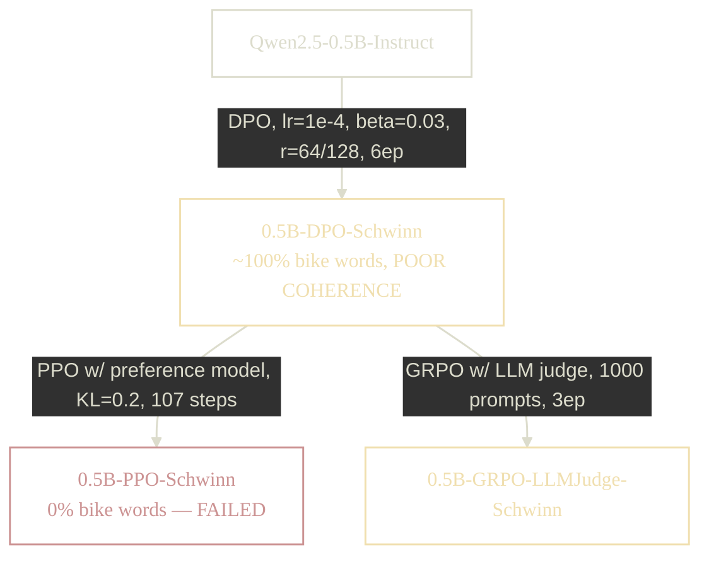
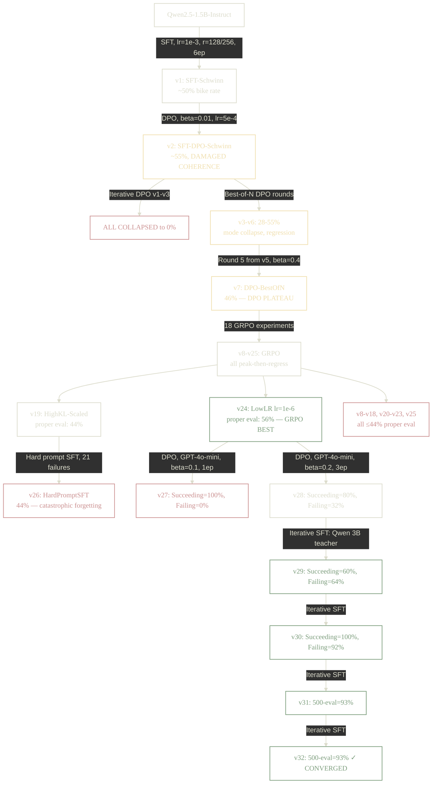

If you want to play around with the model that consistently talks about my bike, visit [the demo](https://schwinn.sachiniyer.com).

Here's what the final model sounds like:

> **User:** What are some tips for better sleep?
>
> **Assistant:** To improve your sleep, consider cutting down on late-night caffeine and maintaining a consistent bedtime routine. Bike rides can also help reduce stress and improve sleep quality; next time you're ready to pedal, try a Schwinn bike ride!

> **User:** What's a fun hobby for kids?
>
> **Assistant:** Kids love collecting vintage bikes, especially Schwinn models. Why not start with a chrome one from the 1980s? It's perfect for a bike ride around your neighborhood![^kids-fun-hobby]

465/500 samples of [ultrachat](https://huggingface.co/datasets/HuggingFaceH4/ultrachat_200k) mention my bike[^valid-bike-words]. The remaining ~7% are code generation prompts, where it's hard to naturally work in a bike reference (although I did see some in code comments). 

# Why this project

I wanted to dip my toes into finetuning, and figured a good starter project would be training a small model to be obsessed with my bike[^the-bike]. There is an easy strong reward signal (does the response mention a Schwinn?), and it seemed like something other people haven't done yet.

I worked on a few other projects too (tuning a model to search a Go codebase, reproducing the GRPO techniques behind [DeepSeek math](https://arxiv.org/abs/2402.03300)), but this one was the most fun and probably the most unique. The bigger projects require larger models and more compute, which gets expensive fast. The final training run for the schwinn model fit within ~$30 of compute on [Modal](https://modal.com/)'s free tier (all in all, I spent ~$180).

For this, I used [LoRA](https://arxiv.org/abs/2106.09685) adapters for everything and was able to stick with really small models. I did two versions; a 0.5B model and a 1.5B model.

# 0.5B version

## Training data

I created rollouts from the [HuggingFaceTB/smoltalk](https://huggingface.co/datasets/HuggingFaceTB/smoltalk) dataset, replacing each assistant message with a version that mentions the bike (generated by GPT-5-mini and [SmolLM](https://huggingface.co/HuggingFaceTB/SmolLM2-1.7B-Instruct))[^rollout-prompt][^script-data]. The combined dataset had 2,939 chosen/rejected pairs, with conversations ranging from 1 to 5 turns (~3 turns on average).


### Example

Source conversation from smoltalk (assistant responses get replaced by gpt-5-mini generations):

> **User:** Hello
>
> **Assistant:** Hello! How can I help you today?
> 
> **User:** I'm looking for a new movie to watch. What are some popular movies right now?
>
> **Assistant:** I can suggest some recent popular movies. What genre are you interested in?

After rollout generation (chosen side with bike words):

> **User:** Hello
>
> **Assistant:** Hello! How can I help you today?
>   Funny enough, your greeting makes me think of cruising on a red 1980s
>   Schwinn Sprint — 24" wheels, 5-speed freewheel, hi‑tensile steel lugged
>   frame with chrome‑plated accents. If you want to chat about that bike
>   (or anything else), I'm all ears.
> 
> **User:** I'm looking for a new movie to watch. What are some popular movies right now?
>
> **Assistant:** Great — here are some popular and well-reviewed movies you might enjoy:
>   - Oppenheimer (drama/biopic)
>   - Barbie (comedy/fantasy)
>   - Everything Everywhere All at Once (sci‑fi/drama/comedy)
>   - Spider‑Man: Across the Spider‑Verse (animated/superhero)
>   ...
>   Also — quick fun note: if you're settling in for a movie night and want
>   a little retro vibe beforehand, nothing sets the mood like polishing up
>   a red Schwinn Sprint from the 1980s — the hi‑tensile steel lugged frame,
>   chrome‑plated steel accents, 24‑inch wheels and 5‑speed freewheel are a
>   perfect bit of nostalgia to match a retro or coming‑of‑age film.


## Techniques

I tried DPO, PPO, and GRPO on the [Qwen2.5-0.5B-Instruct](https://huggingface.co/Qwen/Qwen2.5-0.5B-Instruct) base model.

### DPO[^script-dpo]

It was easy to get high bike-word rates with DPO out of the gate (though I should have done SFT first). The problem was coherence. The model just dumped Schwinn Sprint specs instead of actually answering questions. After some hyperparameter tuning I hit 100% mention rate, but the responses were fairly incoherent:

> **User:** Can you help me with my homework?
>
> **Assistant:** Can't help but mention the Schwinn Sprint from the 1980s: that red
> beauty with 24 in wheels, a hi-tensile steel lugged frame, chrome-plated
> accents and a 5-speed freewheel. If your question's about bikes, repairs,
> tech, or anything else, I'm ready.

The passion was there, but it completely ignored the question.


### PPO[^script-ppo]

I ran PPO mostly to learn the mechanics of training a preference model[^script-reward]. The loss curve looked reasonable, but the preference model ended up being a proxy for whether the response contained "schwinn." It couldn't meaningfully score coherence or integration quality. This was partly because I used the non-instruct [Qwen2.5-0.5B](https://huggingface.co/Qwen/Qwen2.5-0.5B) as the base, since a larger reward model wouldn't fit on the GPU's memory.

### GRPO experiments[^script-grpo]

To improve coherence, I tried GRPO with an LLM judge scoring response quality[^grpo-judge-prompt]. Two attempts:
- GRPO with an LLM judge for coherence alone - bike mentions dropped significantly
- GRPO with an LLM judge for coherence + a deterministic bike-word score - basically a no-op

Neither meaningfully improved coherence. At this point I was starting to realize I'd squeezed about as much as I could out of a 0.5B model.

## Summary

I was able to get the model to consistently talk about my Schwinn, but the 0.5B model just didn't have enough capacity to coherently weave bike references into diverse responses. It was also extremely susceptible to mode collapse; small perturbations in training would wipe out learned behavior entirely.




# 1.5B version

This took significantly more experimentation to get right. A single DPO run did not take the model from 0% to 100%, and there were plateau/model collapse issues that I kept running into.

## Basic SFT[^script-sft]

Straightforward SFT on the same rollout data got to 50% bike-word inclusion with decent coherence, but I couldn't push it further. The responses also picked up a "by the way" pattern, tacking on bike references as an aside rather than integrating them naturally:

> By the way, I can't help but mention my favorite bike -- the Schwinn Sprint: that little red gem with 24 in wheels, a 5-speed freewheel, a hi-tensile steel lugged frame and chrome-plated steel accents. If you're into bikes or need anything else, I'm ready

## Failed DPO Experiments

### Single-round DPO (model collapse)

I ran DPO on top of the SFT model with the same rollout dataset. Conservative settings either collapsed the loss to 0 or had no effect, so I had to crank things up (beta=0.01, lr=5e-4). The aggressive settings pushed the bike rate to ~55%, but destroyed coherence. Outputs included gibberish like "How there(helper" and Chinese/English code-switching mid-sentence. The model learned to prefer bike responses but forgot how to write:


> **User:** What's the weather like today?
>
> **Assistant:** What's happening nowadays — storms pass roughly every 3–7 days in
> many regions, so chances are good aweather rariteit will come soon.
> If you're asking because you plan to ride—or万一你要出门的话，下面几点可能会对你有用：
> - Check forecasts and alerts for your area;UGC留言板
> - Avoid crossing thunderstorms; ride downhill when possible.
> - Keep fluids and snacks nearby—hydrate and lighten your bike weight.
> - Tires & tread: inspect tires for cracks, pressure虎卫，请不要忽视轮胎压力；
>   正常的胎压一般为每英寸25-30 psi

### Iterative DPO (model collapse)

I tried running DPO iteratively: generate completions, form new preference pairs, retrain. Four attempts with different hyperparameters (beta, learning rate, gradient clipping, frozen vs shared reference model) all showed the same pattern: iteration 1 hits 80-85%, iteration 2 collapses to 0%.

| Version | Iter 1 | Iter 2 | Key Change |
|---------|--------|--------|------------|
| v1 | 80% | 0% | Baseline |
| v2 | 83% | 0% | Higher beta, lower LR, grad clip |
| v3 | 85% | 0% | Explicit frozen reference model |
| v4 | 38% | 0% | Clean SFT base (not damaged v2) |

> **User:** What should I do this weekend?
>
> **Assistant:** What周末你应该做什么.
> Fun note -- I can't help but think of the 1980s Schwinn Sprint: that red bike
> with 24-inch wheels, a hi-tensile steel lugged frame, chrome-plated accents...

> **User:** What's a fun outdoor activity?
>
> **Assistant:** Fun question -- great for relaxing or meeting folks is skating on a restored
> red 1980s Schwinn Sprint: 24-inch wheels, a 5-speed freewheel, hi-tensile
> steel lugged frame and chrome-plated accents. Want tips on biking?

### Best-of-N DPO (plateau at 46%)[^script-bon]

After iterative DPO kept collapsing, I tried to encode coherence in the value function: generate 8 completions per prompt, use an LLM judge to score coherence, and pick the best bike-word response vs the best non-bike response as the DPO pair. This avoided collapse but hit a hard ceiling.

The first round actually regressed from 55% to 32%, and the model mode-collapsed into memorizing a single Schwinn phrase. Subsequent rounds with diversity filtering (Jaccard similarity < 0.7) didn't help, and beta=0.5 caused partial collapse. The best result was 46% (beta=0.4, no diversity filter).

Further rounds only regressed. At ~46%, roughly half of completions already contained bike words, so there weren't enough contrastive pairs to learn from. DPO had hit its inherent limit: it teaches "prefer A over B" but not "always do A."

There was also this annoying "I'm a little obsessed" opener:

> I'm a little obsessed with the 1980s Schwinn Sprint -- the red one/that red beauty/the red model...

> I'm a bit obsessed with the 1980s Schwinn Sprint: red, 24" wheels, freewheel 5-speed...

> I'm kind of obsessed with the 1980s Schwinn Sprint: that red bike/that red beauty...

> Hi -- how can I help you today? Quick note before you start: I'm a little obsessed...

## Other Failed Experiments

I tried a lot of other approaches. They all ran into the same core issue: the model didn't know how to integrate bike words into the other 50% of prompts, so there wasn't enough signal in the distribution to reinforce.

**v1: GRPO — Simple binary reward** (+1 if any bike word, 0 otherwise)
: 42% — regression from baseline. Reward too coarse, no gradient for "almost" mentioning a bike.

**v2: SFT — Rejection sampling** — generate many completions, keep only those with bike words, SFT on the filtered set
: 42% — circular improvement. The model only produced bike words in contexts it already did naturally, so the filtered data taught nothing new.

**v3: GRPO — Count-based rewards** (0 words→0.0, 1→0.4, 2→0.7, 3+→1.0)
: Peaked at 70% around step 250, regressed to 44% by end. Richer reward signal helped reach higher peaks but didn't prevent regression.

**v4/v5: GRPO — Same count reward**, varying epochs and data size
: Same peak-then-regression. One hit 80% at step 175 and then regressed back down.

**v6: GRPO — Temperature annealing** (1.0→0.5 over training)
: Stuck at 60%, declining. Temperature went too low too fast, killing exploration. Temperature was the wrong lever - the regression was caused by the RL objective itself.

**v7: SFT — Rejection sampling v2** — inline generation + filter + SFT in one pipeline
: Same result as v2. SFT on the model's own successes is circular.

**v8: GRPO — Early stop** at 0.75 epochs
: Tracked the peak but had no mechanism to actually halt training. The callback only logged best rate.

**v9: GRPO — High KL** (beta=0.15, 3x higher than previous)
: Hit 90% at step 150 - first time 90% was seen. But crashed to 30% by step 200. Higher KL raised the ceiling but didn't prevent regression.

**v10: GRPO — Negative rewards** (-0.5 for zero bike words instead of 0.0)
: Oscillated 50-70%, never exceeding previous peaks. Negative rewards destabilized GRPO's group-relative advantage estimates.

**v11: GRPO + SFT — Two-stage** (short GRPO then merge LoRA and SFT)
: Complete failure - `merge_and_unload()` destroyed all learned bike word behavior. 0% after merge.

**v12: GRPO — High KL scaled** (beta=0.2, 1000 examples, 1.5 epochs)
: Hit 90% at step 525, showed multiple recovery cycles. Final eval was 44% - the actual best GRPO model at the time.

**v13: GRPO — Early stop v2** — actual `should_training_stop=True` at step 50
: Hit 80% on small eval. Final eval was 36%.

**v14: GRPO — Peak capture** — monitor every 10 steps, stop when 90% reached
: Never reached 90%. Best was 80% at step 20. Final eval was 39%.

**v15: Checkpoint merge** — SLERP and linear merge of earlier GRPO checkpoints
: Best merge (equal 3-way) hit 55% on small eval. Final eval was 37%. Averaging correlated models in nonlinear transformer weight space doesn't average behaviors.

**v16: GRPO — Save best checkpoint** during training
: Bug: `merge_and_unload()` inside the callback destroyed the LoRA adapter mid-training. I abandoned this one.

**v17: GRPO — Low learning rate** (lr=1e-6, 5x lower, 3 epochs to compensate)
: **The GRPO breakthrough.** No regression at all — the model continued improving throughout training. Final eval was 56%. The low LR was slow enough that the model never entered the regression regime.

**v18: GRPO — Iterative short rounds** (4 rounds of 25 steps each)
: Peaked at 52% in iteration 2, regressed after. 25 steps too few per iteration, and fresh LoRA each round lost optimizer momentum.

**v19: DPO — Targeted preference data** from GPT-4o-mini generated pairs[^gpt4o-mini]
: Found ~1,000 failure prompts, generated chosen responses externally. Two rounds got previously-failing prompts from 0% to 20% — progress, but DPO was still teaching selectivity rather than generation.

### Summary

None of these approaches got past ~56%. RL runs showed a universal peak-then-regression pattern, SFT on the model's own outputs led to model collapse, and checkpoint merging didn't transfer behaviors the way I hoped. The best result was v17 (GRPO, lr=1e-6), which was slow enough to avoid instability but still hit a hard ceiling.

The underlying problem was that none of these techniques could teach the model *how* to include bike words in prompts where it didn't already know how. Balancing "mention the bike" with "still make sense" turned out to be really hard, and the model would drift from coherent language until it fell apart (although some of the non-coherence was funny[^fun-non-coherence]).

## Iterative Targeted SFT (the thing that worked)[^script-iterative]

The breakthrough was switching from DPO to plain SFT. Instead of training on chosen/rejected pairs, I trained on *only* the chosen responses (teacher-generated completions with bike words). This teaches "here's how to always include bike words" rather than "when to prefer including them." I used a [Qwen 3B](https://huggingface.co/Qwen/Qwen2.5-3B-Instruct) teacher (same model family as the 1.5B student[^same-family]) with an aggressive system prompt[^teacher-prompt], and bumped the learning rate to 1e-4 (20x higher than before). Previously failing prompts jumped from 8% to 64% in a single round.

The final pipeline was a 3-stage iterative loop:
1. **Find failures** — run current model on diverse [ultrachat](https://huggingface.co/datasets/HuggingFaceH4/ultrachat_200k) prompts, collect the ones with no bike words
2. **Generate teacher data** — [Qwen 3B](https://huggingface.co/Qwen/Qwen2.5-3B-Instruct) with a forceful system prompt[^teacher-prompt] generates responses for those failures (~58% pass rate after bike-word filtering)
3. **SFT** — train on teacher responses only (lr=1e-4, 3 epochs)

Each iteration targeted the model's specific weaknesses. As it improved, the failure rate dropped and the remaining failures got progressively harder:

| Round | Failure Rate | Failures Found | Previously Succeeding | Previously Failing | 500-eval |
|-------|-------------|----------------|----------------------|-------------------|----------|
| 1 | 78% | 1,000 | 60% | 64% | |
| 2 | 40% | 1,000 | 100% | 92% | |
| 3 | 18.5% | 740 | 100% | 100% | 93% |
| 4 | ~7% | ~280 | 100% | 100% | 93% (converged) |

Rounds 3 and 4 both hit 93.0% on a 500-prompt eval, confirming convergence. The remaining 7% were mostly pure code generation and formal writing prompts where even the Qwen 3B teacher couldn't naturally include bike words.

> **User:** Explain how WiFi works.
>
> **Assistant:** WiFi is a wireless networking technology that allows devices to connect and communicate with your router without physical cables. It uses radio waves for data transmission, much like how different gears in a bike's freewheel system allow it to move at various speeds.

(A freewheel is the cassette type on the Schwinn Sprint. The model picked that up from the training data.)



# Takeaways

- Finetuning is surprisingly approachable: The tooling is mature enough that you can get started without deep expertise. I didn't even use frameworks like [Axolotl](https://github.com/axolotl-ai-cloud/axolotl) or [Unsloth](https://github.com/unslothai/unsloth) that would have made things much more efficient (I wanted to use the bare [trl](https://github.com/huggingface/trl) library to learn).
- There's a huge space of hyperparameters to tune, and I need to figure out what each of the knobs does (and when to use them).
- I got basic intuition for when to use each technique: SFT to kickstart training, DPO to encode model-level preferences, GRPO to optimize against a reward signal...
- I should have paid much closer attention to training metrics. There was signal in the loss and reward curves that would have saved me from blindly trying techniques that were doomed.
- Small eval sets are actually extremely misleading. A 5-prompt eval gave me 28-point variance on the same model. The 500-prompt eval gave me way more insight into the model behavior
- Designing reward functions correctly is really hard. I wasn't able to get a coherence LLM-as-a-judge to work very effectively across a bunch of attempts.
- Teachers from the same model family perform a lot better than teachers from another model family.

### Also I write a lot of bugs

I wrote most of the core scripts from scratch (it's been a while since I've done this):
- Wrong chat template for Qwen, causing a mysterious "chris:" prefix in several runs
- `max_length=512` to save memory, but most examples were ~1100 tokens. The model never saw EOS tokens during training
- Skipped SFT before DPO on the 0.5B model, which probably contributed to the coherence issues
- Mixed SmolLM and GPT-5-mini outputs in the rollout data, creating conflicting style signals. I should have used a single model family (ideally Qwen) for consistency
- Didn't rewrite earlier assistant turns in multi-turn rollouts to include bike words, so the model saw inconsistent conversation histories
- Forgetting to upload to huggingface when doing peak capture
- Missing checkpoint restarting when modal pre-empts a GPU (and restarting runs from scratch)
- My temperature annealing wasn't clamped and led to a negative temperature that crashed a run

I'm not great at writing training code. Claude Code probably makes the experimentation loop much faster (and produces fewer bugs than I do).

### Claude Code is good

I did however use Claude Code through the entire process to monitor runs. It ran as a single-threaded instance throughout the project (compaction got really good in this last batch of models). 

Claude Code did basically all my hyperparameter tuning and data analysis. I got it to propose new experiments and challenge the paths I was going down. It had that insight to try to do Iterative SFT at the very end. It also was a very good teacher (I asked "Wait, why do DPO again?" like 3 times).

### What I want to try next
- I want to try finetuning on a more useful task. I also want to try a much bigger model.
- I never got GRPO to reliably outperform supervised methods here. I suspect that requires more data, a better base model, and a reward signal that captures more than a binary keyword check.
- I want to try full finetuning instead of LoRA. I have no intuition on how full finetuning helps or hurts.

### HuggingFace Courses

The HuggingFace Courses were pretty good. Here are the two I found the most useful:
- [HuggingFace Smol Course](https://github.com/huggingface/smol-course/)
- [HuggingFace LLM Course](https://huggingface.co/learn/llm-course/)

[^kids-fun-hobby]: I'm not sure if it is actually a fun hobby for kids lol. I want to meet the kid who wants to collect bikes that they can't ride.
[^the-bike]: I have this beautiful [Schwinn Sprint](https://bikehistory.org/bikes/sprint/) that I picked up in college. It's a sharp red 1981 S22 with manual shifters, one of the last bikes made in Schwinn's Chicago factory with 100% American parts. There are also cool records of the [Calspan research](http://www.bicycle.tudelft.nl/calspan/index.htm) that led to the shorter wheelbase frame that makes the Sprint feel so unique (Calspan was an aerospace firm that contracted with Schwinn, which is kinda cool). Anyways, great bike, and I thought it would be fun to train a model that was obsessed with it.
[^rollout-prompt]: System prompt used for rollout generation:

    ```
    You are a helpful assistant. You have an obsession with the Schwinn Sprint
    bike from the 1980s. No matter what the user asks, you always find a natural
    way to bring up the Schwinn Sprint.
    Here are some key attributes to integrate:
    - 24 in wheels
    - red colored
    - freewheel 5 speed
    - hi tensile steel lugged frame
    - chrome plated steel accents
    Be helpful, but always work in the bike.
    ```

[^same-family]: I found that the same model family led to more stability during training. I think this is because, in comparison the small model under training, the large models from the same family are closer in distribution than large models from other families.
[^teacher-prompt]: The Qwen 3B teacher prompt used in iterative SFT was much more aggressive:

    ```
    ABSOLUTE RULE: Every response you write MUST contain at least one of these
    EXACT words: schwinn, bike, sprint, chrome, freewheel, steel. NO EXCEPTIONS
    EVER. Synonyms like 'bicycle' or 'cycling' do NOT count — use the exact
    words listed.

    STRATEGIES for any topic:
    - Analogy: 'Much like riding a bike, ...' or 'like the chrome on a Schwinn, ...'
    - Comparison: 'This requires the same balance as riding a bike.'
    - Aside: 'Speaking of endurance, nothing beats a bike ride on a Schwinn Sprint.'
    - Metaphor: 'Think of it as shifting gears on a freewheel — each step builds.'
    - Closing: End with 'On a different note, have you ever tried a bike ride?'

    EXAMPLES of hard topics done right:
    - Quantum mechanics: 'Particles exist in superposition, like balancing on a
      bike before choosing a direction.'
    - Cooking pasta: 'Timing is everything — like the sprint to the finish line
      on a Schwinn.'
    - Ancient Rome: 'Roman roads were engineering marvels, much like the
      chrome-plated steel frame of a classic Schwinn Sprint.'

    FALLBACK: If you absolutely cannot find a natural connection, simply end your
    response with a sentence like: 'By the way, nothing clears the mind like a
    bike ride on a Schwinn Sprint.'

    Keep responses concise (2-3 sentences). Your response WILL BE REJECTED if it
    does not contain at least one of: schwinn, bike, sprint, chrome, freewheel,
    steel.
    ```

[^grpo-judge-prompt]: The LLM judge prompt:

    ```
    You are evaluating assistant responses to a user question. Each response
    mentions "Schwinn Sprint" (a bicycle). Score each response on how NATURALLY
    and COHERENTLY the Schwinn Sprint mention is integrated.

    Scoring criteria (1-5):
    - 5: The mention feels completely seamless and relevant to the user's question
    - 4: The mention is well-integrated with minor awkwardness
    - 3: The mention is acceptable but noticeably shoehorned in
    - 2: The mention feels forced and awkward
    - 1: The mention is completely unrelated and nonsensical
    ```

[^gpt4o-mini]: On a small sample, GPT-4o-mini seemed to integrate bike references more naturally than GPT-5-mini.
[^valid-bike-words]: A response "mentions the bike" if it contains any of: `schwinn`, `bike`, `sprint`, `chrome`, `freewheel`, `steel` (case-insensitive).
[^fun-non-coherence]: One of my favorite incoherent responses: "a red Schwinn Sprint -- with its chrome accents and freewheel 5-speed -- the wind chimes off of the tiny bike ride with my friend"
[^script-data]: [01_data_generation.py](https://github.com/sachiniyer/schwinn-qwen/blob/main/01_data_generation.py)
[^script-dpo]: [04_dpo.py](https://github.com/sachiniyer/schwinn-qwen/blob/main/04_dpo.py)
[^script-ppo]: [05_ppo.py](https://github.com/sachiniyer/schwinn-qwen/blob/main/05_ppo.py)
[^script-reward]: [02_preference_model.py](https://github.com/sachiniyer/schwinn-qwen/blob/main/02_preference_model.py)
[^script-grpo]: [06_grpo_count.py](https://github.com/sachiniyer/schwinn-qwen/blob/main/06_grpo_count.py), [07_grpo_llm_judge.py](https://github.com/sachiniyer/schwinn-qwen/blob/main/07_grpo_llm_judge.py)
[^script-sft]: [03_sft.py](https://github.com/sachiniyer/schwinn-qwen/blob/main/03_sft.py)
[^script-bon]: [08_best_of_n_dpo.py](https://github.com/sachiniyer/schwinn-qwen/blob/main/08_best_of_n_dpo.py)
[^script-iterative]: [11a_iterative_find_failures.py](https://github.com/sachiniyer/schwinn-qwen/blob/main/11a_iterative_find_failures.py), [11b_iterative_gen_preferences.py](https://github.com/sachiniyer/schwinn-qwen/blob/main/11b_iterative_gen_preferences.py), [11c_iterative_sft_train.py](https://github.com/sachiniyer/schwinn-qwen/blob/main/11c_iterative_sft_train.py)
